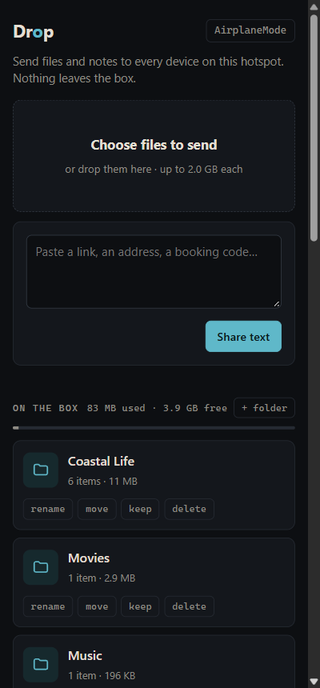
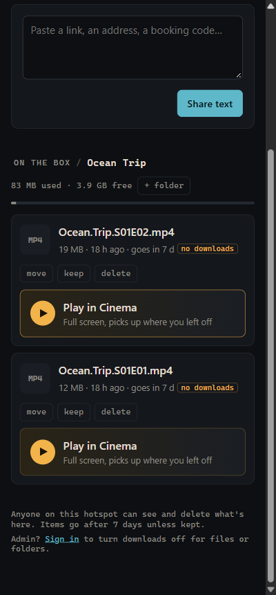
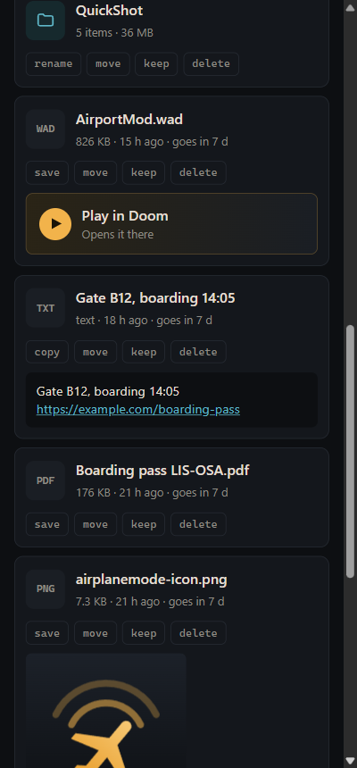

<p align="center"></p>

# Drop: pass files between every device on the hotspot

An [AirplaneMode](https://github.com/jessewolcott/airplanemode) app. Anyone on your
AirplaneMode hotspot can drop files and notes on the box, and every other phone, tablet and
laptop sees them a few seconds later, whatever the operating system. Nothing leaves the box.

<p align="center">
  
  
  
</p>

<sub>Screenshots from the laptop dev stack; not yet tested on real hardware.</sub>

- **Files:** choose or drag several at once, with a progress bar each. Photos show in the
  list, and video and audio play right in the page, with seeking (HTTP Range).
- **Text:** paste a link, an address or a booking code; others tap **copy**.
- **Folders:** make folders (and folders inside them), send files straight into the one
  you're in, and **move** things between them. **Keep** on a folder keeps everything in it.
- **For the flight:** load movies and music before you leave, tap **keep**, and they stay.
  Everything else goes after 7 days.
- **Plays in Cinema:** on the box, videos and music get a **Play in Cinema** button (when this
  device can play the file), which opens the
  [Cinema](https://github.com/jessewolcott/airplanemode-cinema) app's full-screen player. Without
  Cinema (or with the admin's switch off), they play right in the list.
- **Plays in Doom:** `.wad` files (your own `DOOM.WAD`, `DOOM2.WAD`, or mods) get a
  **Play in Doom** button that opens them in the
  [Doom](https://github.com/jessewolcott/airplanemode-doom) app, which also lists every WAD in
  Drop on its start page.
- **Downloads off (admin):** whoever is signed in to the AirplaneMode admin panel can turn
  downloads off for a file or a whole folder. Everyone can still play it on the box; nobody
  else gets a **save** button, and the server refuses to hand out a copy.

## Running it

**On the box:** the platform repo runs the released image at `/drop/`.

**On its own, for development:**

```
docker compose up -d --build        # http://localhost:8766
python tests/test_drop.py           # API tests (CI runs these before building)
```

Use another port with `PORT=9000`.

## Settings

| Variable | Default | Meaning |
|---|---|---|
| `DROP_MAX_BYTES` | `4g` | total space Drop may use (`k`/`m`/`g` suffixes) |
| `DROP_MAX_FILE` | `2g` | largest single file |
| `DROP_KEEP_DAYS` | `7` | days before an item is deleted, unless someone tapped **keep** |
| `ADMIN_URL` | *(empty)* | the platform's admin service (`http://admin:8000` on the box), to recognise the admin. Empty: nobody is admin |

Files and `items.json` live in one volume at `/data`. Free space shown in the page is the
smaller of what's left of `DROP_MAX_BYTES` and the disk's free space minus 64 MB.

## How it's built

- **Uploads are streamed to disk** (`PUT api/files?name=…`, the raw file as the body), never
  held in memory: a 700 MB upload peaks at about 36 MB of RAM. They're written to
  `/data/tmp` and renamed into place only when complete. Cancelled or cut-off uploads are
  deleted, and leftovers from a restart are cleaned up at startup. Size limits are checked
  from `Content-Length` before anything is written, and again while the data arrives (for
  uploads without a length). Space being uploaded is held, so two uploads at once can't
  overfill the box.
- **Client file names are never used as paths.** Files are stored by a random 16-hex-digit
  id, and the name is only metadata. Downloads send it as RFC 5987 `filename*`.
- **Uploaded files can't run as pages on the box.** Only images (not SVG), audio, video and
  plain text are shown inline (plus Doom WADs, under a type browsers can't render, so the Doom
  app can read them). Everything else downloads as `application/octet-stream`, and
  every file response has `X-Content-Type-Options: nosniff` and a `sandbox` CSP. This matters
  because Drop shares an address with the box's admin panel.
- **The page refreshes the list every 4 seconds** but only rebuilds what changed, so a video
  that's playing keeps playing.

## Who can do what

There's no login. **Anyone on the hotspot can see, keep, move and delete everything**, and
download anything the admin hasn't turned downloads off for, so the hotspot password is the
access control.

**The admin** is whoever is signed in to the AirplaneMode admin panel. Drop is served from the
same address, so the browser sends it the panel's session cookie; Drop asks the admin service
(`GET /api/admin/session`) whether it's valid and remembers the answer for 30 seconds. Only the
admin can turn downloads on or off. "Downloads off" refuses `?dl=1` and attachment-only types
for everyone else, while streaming (with seeking) keep working, so films still play. It stops
casual copies filling up phones; it can't stop someone recording what's playing. Changes need an `X-Drop: 1` header, which
other websites can't send without a CORS preflight that Drop never allows, so a web page
open on a phone can't add or delete items.

## Releasing

Push a tag like `v0.1.0`. GitHub Actions runs the tests and publishes
`ghcr.io/jessewolcott/airplanemode-drop:0.1.0` for arm64 and amd64. Make the package public,
then pin the tag in the platform repo's `compose.yaml`.
